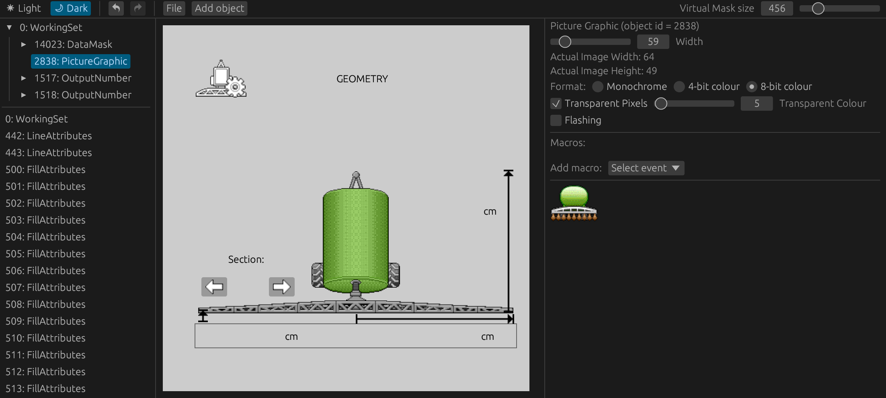

<div align="center">

# AgIsoTerminalDesigner 🚜

— <ins>**Ag**</ins>riculture <ins>**ISO**</ins>-11783 Virtual <ins>**Terminal Designer**</ins>

The experimental graphical editor for designing a Virtual Terminal (VT) for everyone - from hobbyists to industry!

[Web Application](https://open-agriculture.github.io/AgIsoTerminalDesigner/) |
[Issues & Suggestions](https://github.com/Open-Agriculture/AgIsoTerminalDesigner/issues) | [Discord](https://discord.gg/uU2XMVUD4b) | [Telegram](https://t.me/+kzd4-9Je5bo1ZDg6)

[](#)
[](LICENSE)
[](https://github.com/sponsors/GwnDaan)



</div>

> AgIsoTerminalDesigner simplifies creating and editing object pools for ISOBUS terminals by providing a graphical interface, enabling anyone to design their own virtual terminal interfaces.

- [Current Status](#current-status)
    - [Features](#features)
    - [What's Next](#whats-next)
    - [Supported Objects](#supported-objects)
- [Installation](#installation)
    - [Prerequisites](#prerequisites)
    - [Running standalone](#running-standalone)
    - [Running the Web Application](#running-the-web-application)
- [Contributing](#contributing)
- [Disclaimers](#disclaimers)

## Current Status

This project is under **active development**. While some features may not yet be fully supported or fully compliant with AEF standards, improvements are ongoing.

### Features

- [Web version](https://open-agriculture.github.io/AgIsoTerminalDesigner/) for easy access
- Load and save object pools from/to files
- Browse the focused mask's placement and linked soft-key hierarchy, or search all objects by name/ID
- Rearrange the workspace with dockable tabs, splits, and floating panes; layouts persist locally
- Follow the system appearance or choose coordinated light and dark themes
- Use hyperlinks to navigate to referenced objects
- Preview multiple data/alarm masks with their linked soft keys on one canvas; edit the focused mask with undo/redo
- Limit selecting macro's and object references to allowed types only.
- Assign allowed references to object pointers and switch their active target with a dropdown in the properties panel. Empty lists keep unrestricted selection; lists are saved in `.aitp` projects, while IOP export contains only the active target.

### Interactive layout editor

Check masks in the Objects pane to preview them side by side. Click a mask row or its preview to focus it; clicking the focused row again clears its hierarchy. The mask-list filter and pool-wide object filter work independently. Zoom/pan is shared, while soft-key pages are independent per mask. Select placements in the canvas or objects from the hierarchy. Dragging updates the selected placement within its current parent. Parent bounds, dimensions, local coordinates, alignment guides, and spacing measurements appear during editing. Dragging and resizing stop at parent boundaries. Sidebar and CLI edits that introduce or increase overflow are rejected, including parent and mask-size reductions. Shared dimensions must fit every placement. Existing out-of-bounds layouts can still be loaded and repaired without increasing their overflow.

| Control | Action |
| --- | --- |
| Shift-click / drag empty canvas | Toggle selection / marquee selection |
| Double-click or Enter / Shift+Enter | Enter children / select parent |
| Ctrl-click / Ctrl-marquee | Select nested objects |
| Shift-drag / Ctrl-drag | Constrain movement / bypass snapping |
| Alt-drag / Ctrl+D | Duplicate independently editable primitive objects and positioned descendants |
| Alt-hover | Measure spacing to another object or the parent |
| Arrow / Shift+Arrow | Move by 1 / 10 pool pixels |
| Resize handle + Shift / Alt | Preserve aspect ratio / resize from center |
| Delete / Escape | Remove selected placements / cancel a gesture or clear selection |
| Space-drag or middle mouse | Pan |
| Ctrl-wheel | Zoom around the pointer |
| Shift+1 / Shift+2 | Fit mask / fit selection |

The canvas toolbar provides X/Y and supported W/H fields, alignment/distribution, snapping switches, and a shortcut reference. Alignment and distribution operate on selections sharing a parent; hold Shift while aligning to align the selection as a group to that parent.

Moving a repeated reference updates its exact child-list occurrence. Resizing changes the shared object's dimensions at every reference; the toolbar identifies shared dimensions. Removing a placement retains its primitive object definition in the pool. Component instances move and duplicate as units; their internal geometry stays controlled by their component definitions.

Primitive copies receive fresh object IDs and metadata identities. Internal references within the copied positioned subtree are remapped; external styles and resources remain shared. Component copies retain their master and overrides. Completed gestures and numeric edits each create one undo action.

### Output String preview

Output Strings use the selected VT version's presentation rules from ISO 11783-6:2018 §4.6.19: character-cell justification before VT4 and pixel-based justification from VT4, wrapping, control characters, and clipping to the object's dimensions. Font Attributes control character dimensions, styles, inversion, and flashing. The preview flashes on a one-second cycle; proportional fonts are available from VT4.

Imported strings retain their original bytes and decode using their ISO-8859 font character set or UTF-16LE BOM. Editing text converts it to Unicode, exported as a UTF-16LE WideString (VT version 4 and later). Unsupported proprietary encodings display a diagnostic. Export rejects strings exceeding their encoded byte-length limit. A shared String Variable is decoded separately for each rendered field; its text editor uses the first referencing field's character set.

Project Settings supports VT2–VT6 with compatibility checks, undo/redo, and version-aware authoring and preview. VT2/VT3 export uses the consumers' 8-bit font encodings and rejects unrepresentable text. Raw IOP import asks for its target version and rejects malformed records. Existing incompatible projects remain editable for repair; binary export waits until they are compatible. New `.aitp` saves use lossless authoring format v2, while v1 files remain readable. See [Designer settings](docs/project-settings.md).

### What's Next

The list below outlines some of the features and improvements that are planned to be implemented in the future. The order is a good indication of the priority.

- Add the remaining objects for configuration and rendering.
- Display a preview of the active soft key mask.
- Implement the ability to give objects custom names.
- Add a colour picker for colour attributes.
- Add a search bar to quickly find objects.
- Show a pop-up when creating a new object for initial configuration.

If you have any suggestions or would like to contribute, feel free to open an issue or submit a pull request!

### Supported Objects

The lists below only apply to version 3 of the VT specification. There are 3 stages of development for each object: **Not Started** [ :white_circle: ], **In Progress** [ :yellow_circle: ], and **Completed** [ :green_circle: ]. Open an issue if you would like to prioritize a specific object, or even better, submit a pull request to help implement it!

#### Configurable Types

- :yellow_circle: WorkingSet (missing language codes)
- :green_circle: DataMask
- :green_circle: AlarmMask
- :green_circle: Container
- :green_circle: SoftKeyMask
- :green_circle: Key
- :yellow_circle: Button (missing options, keycode, border colour)
- :green_circle: InputBoolean
- :green_circle: InputString
- :green_circle: InputNumber
- :green_circle: InputList
- :green_circle: OutputString
- :green_circle: OutputNumber
- :yellow_circle: OutputList
- :yellow_circle: OutputLine
- :yellow_circle: OutputRectangle
- :yellow_circle: OutputEllipse
- :yellow_circle: OutputPolygon
- :yellow_circle: OutputMeter
- :yellow_circle: OutputLinearBarGraph
- :yellow_circle: OutputArchedBarGraph
- :yellow_circle: PictureGraphic (missing loading images from file)
- :yellow_circle: NumberVariable
- :yellow_circle: StringVariable
- :yellow_circle: FontAttributes
- :yellow_circle: LineAttributes
- :yellow_circle: FillAttributes
- :yellow_circle: InputAttributes
- :green_circle: ObjectPointer
- :yellow_circle: Macro
- :yellow_circle: Auxiliary Function Type 2
- :yellow_circle: Auxiliary Input Type 2
- :yellow_circle: Auxiliary Control Designator Type 2 Object Pointer

#### Renderable Types

- :green_circle: WorkingSet
- :yellow_circle: DataMask (missing soft key mask)
- :yellow_circle: AlarmMask (missing soft key mask)
- :green_circle: Container
- :white_circle: SoftKeyMask
- :yellow_circle: Key
- :green_circle: Button
- :yellow_circle: InputBoolean
- :white_circle: InputString
- :yellow_circle: InputNumber
- :white_circle: InputList
- :yellow_circle: OutputString
- :yellow_circle: OutputNumber
- :white_circle: OutputList
- :yellow_circle: OutputLine
- :yellow_circle: OutputRectangle
- :white_circle: OutputEllipse
- :white_circle: OutputPolygon
- :white_circle: OutputMeter
- :white_circle: OutputLinearBarGraph
- :white_circle: OutputArchedBarGraph
- :green_circle: PictureGraphic
- :green_circle: ObjectPointer
- :yellow_circle: Auxiliary Function Type 2
- :yellow_circle: Auxiliary Input Type 2
- :yellow_circle: Auxiliary Control Designator Type 2 Object Pointer


## Installation

### Prerequisites

- Rust toolchain (stable)
- (optional) `libgtk-3-dev` for building the native version on Linux
- (optional) [Trunk](https://trunkrs.dev/) for building the web version

### Running standalone

```bash
cargo run --release
```

### Automating the desktop editor

Build both the editor and the `aitd` CLI, then run the editor with a project open:

```bash
cargo build --release
cargo run --release
```

The CLI is at `target/release/aitd`. Add that directory to `PATH`, or invoke it by its full path. `aitd` uses commands for input and supports readable text or structured JSON output. Start with `aitd --help` or see the [CLI guide](docs/cli.md):

```bash
aitd status
aitd object list --type Button
aitd object set 10 width=120
aitd --check run --file changes.aitd
aitd run --file changes.aitd
aitd export bundle --iop build/object_pool.iop --header build/object_pool.h
```

The CLI edits the project open in the desktop editor immediately, through the same validated editing APIs used by the UI. Each edit, or an entire command file, is one undoable action. A failed command file leaves the project unchanged; `--check` validates without applying. Inputs are shell commands and plain command files, including field assignments for structured properties; JSON is supported only for output. Project saving remains an editor action. The browser editor remains manual-only. See the [CLI guide](docs/cli.md) for edit syntax, project guards, validation, exports, completion, and exit codes.

If multiple editors are running, use `--instance <editor-instance-id>` or set `AG_ISO_EDITOR_INSTANCE_ID`. Connection details are in owner-only runtime files under the system temporary directory in `ag-iso-terminal-designer-<user>/`. The authenticated loopback bridge currently requires Unix owner-only file permissions.

### Running the Web Application

```bash
trunk serve --release
```

Then open your browser at `http://localhost:8080`.

## Contributing

This project is still a work in progress, and contributions are appreciated! Feel free to open issues or submit pull requests to help improve the project.

## Disclaimers

Because this software is licensed under the GPL v3.0, you may not include this software in any closed source software, nor link to it in any way from closed source software.

This project is not associated with the Agricultural Industry Electronics Foundation (AEF) in any way.

This project is not associated with the International Organization for Standardization (ISO) in any way.

Don't ask us to share the ISO standards with you. We can't. You have to buy them from ISO. We don't have the right to share them with you.

This software was not created to compete with any commercial or open-source software. It was created to help hobbyists and professionals alike learn about and experiment with ISOBUS.
